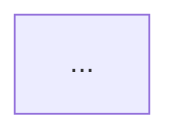

# Reply Architecture

Use this skill as a response-level companion. It summarizes the answer that is about to be shown; it does not replace the answer, rewrite the user's request, or invoke `traceify` on the user's original source. Keep the existing answer content intact and add a compact visual index when the activation rules below are met.

## Activation

Before finalizing a response, estimate whether it is long or structurally dense. Activate when any of these is true:

- at least 900 non-whitespace characters, or at least 700 whitespace-delimited words;
- at least 5 meaningful sections/headings, or at least 4 ordered steps;
- the response contains a multi-stage plan, a decision tree, a system architecture, or several dependent claims even if it is shorter.

Do not activate when the response is a greeting, a one-step answer, code-only output, a small table, a direct translation, or the user explicitly requests no diagram. If the diagram would add more noise than orientation, state that judgment internally and omit it.

The helper `scripts/measure_response.py` can make the threshold decision. It is a routing aid, not a substitute for judgment.

## Workflow

1. **Freeze the answer.** Treat the response text as the source. Do not invent a claim, citation, dependency, or action that is absent from it. Keep code blocks and quoted material intact; they are content, not structure unless the prose explains them.
2. **Segment.** Assign stable fragment IDs (`r-p1`, `r-p2`, …) to paragraphs or headings. Use a sentence fragment only when one paragraph contains clearly independent ideas. Keep a short excerpt for each fragment.
3. **Extract the reading spine.** Identify the response goal, starting context, actors, artifacts/evidence inspected, operations, state transitions, decisions/branches, outputs, risks/limits, and follow-up actions. For a complex response, retain 8–12 meaningful nodes rather than collapsing it into a generic five-stage pipeline. Preserve concrete numbers, statuses, filenames, requirement IDs, equations, or failure reasons when they are present.
4. **Build the graph.** Create stable node IDs (`a-...`) and edge IDs (`r-...`). Use relation labels such as `reads`, `compares`, `finds`, `changes`, `blocks`, `produces`, `qualifies`, or `decides`; choose labels that match the answer. Attach every important node and edge to one or more response fragments. Mark an inferred relationship with lower confidence and `ai_suggestion` provenance. A complex graph should visibly include at least one evidence/artifact node, one decision or state node, one concrete result, and one limitation or risk node when the response contains them.
5. **Render the diagram.** Prefer a Mermaid `flowchart TD` for causal or sequential answers and `flowchart LR` for pipelines or architectures. Keep labels short, quote Mermaid-sensitive text, and use subgraphs only for real sections. Limit the default diagram to 12 nodes, but use the full budget for a genuinely complex response; use branches, evidence lanes, or decision points instead of one artificial linear chain. Move only supporting detail into the reading map. Use a colorful semantic palette by default: the root/goal should be a strong accent, processes and evidence should use distinct cool hues, decisions should use amber, results should use green or cyan, and risks or limits should use coral/red. Do not fall back to a black-and-white diagram when Mermaid or HTML styling is available. Pair color with node labels, shapes, or prefixes so meaning remains readable for color-blind users. If Mermaid is unavailable, provide the same graph as an indented outline with IDs.
6. **Place it for scanning.** Put a one-sentence orientation followed by the diagram immediately after the answer's opening sentence or short executive summary. Then keep the detailed answer. Add a `阅读地图` with 3–7 bullets only when the diagram alone cannot show the hierarchy.
7. **Expose uncertainty.** Add a compact `图中约定` line when needed: solid arrows are explicit relationships, dashed arrows are inferred, and `?` marks a low-confidence link. Never turn a diagram inference into a factual assertion in the prose.
8. **Check fidelity.** Every diagram node must map to visible response text. The diagram must preserve the response's order when order matters, retain caveats near the node they qualify, and avoid implying a stronger causal relationship than the prose supports.

## Information-density guardrail

Do not use generic labels such as `核心能力`, `配套资源`, `验证结果`, or `处理步骤` as the main content of a complex graph. Those may be section labels, but each connected node must say what was inspected, changed, decided, measured, or left unresolved. If a session contains state counts, error codes, progress, file names, or acceptance checks, keep the most decision-relevant values in the graph. A good graph lets a reader recover the answer's main conclusion and its reason without reopening every paragraph.

## Response format

Use this shape only when activated:

```markdown
> **阅读导航**：一句话说明这份回答从哪里出发、经过哪些主线、最终得到什么。



**阅读地图**
- `a-...` 主线：对应回答的哪一部分。
- `a-...` 决策/风险：需要重点核对什么。

图中约定：实线表示回答中明确表达的关系；虚线表示基于回答结构的推断。
```

When colors are used, add a compact legend or explain the semantic palette in the `图中约定` line. Keep contrast high in both light and dark themes; avoid using color as the only indication of risk, decision, or completion.

Use the exact heading `阅读导航` only if the response is Chinese; use `Reading map` for English responses. Do not add a second full summary that duplicates the answer. Keep the diagram readable on a narrow screen and keep the map shorter than the body.

## Contract and tooling

Read [references/response-contract.md](references/response-contract.md) when producing machine-readable graph data, persisting a diagram, or handing the result to another agent. It adapts traceify's stable-ID and evidence-mapping ideas to a single generated response.

Use [references/diagram-guidelines.md](references/diagram-guidelines.md) when choosing layout, node limits, or Mermaid fallbacks. For a deterministic first pass, run:

```powershell
python scripts/measure_response.py --input response.md --json
python scripts/render_response_graph.py --input response.md --format markdown
```

The renderer is a scaffold: the agent must review labels and relationships against the response before showing them. It must never be treated as evidence extraction from an external source.

## Scope boundary

This skill covers architecture views of the current AI response. Keep source-to-graph work, editable knowledge graphs, bidirectional mappings, and one-source evidence workflows in `traceify`. Do not modify, import, or silently expand `traceify`; this skill may borrow its stable-ID conventions but remains independently installable.
