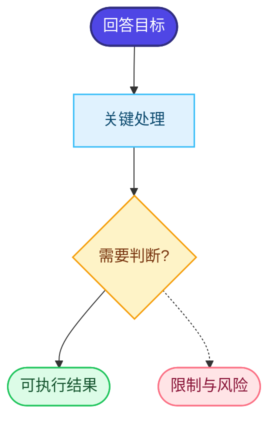

# Diagram guidelines

## Choosing a layout

- `TD` (top to bottom): explanation, plan, decision tree, or cause-and-effect.
- `LR` (left to right): system pipeline, lifecycle, workflow, or architecture.
- Use one root node for the answer's goal or outcome. If the answer has parallel branches, connect them to a decision or section node instead of making several competing roots.

## Readability limits

- 5–12 visible nodes in the default diagram; put examples and sub-details in the body.
- Keep labels under roughly 45 characters where possible.
- Use one subgraph per major section, at most four subgraphs.
- Prefer explicit edge labels over unlabeled arrows when the relationship is not obvious.
- Use dashed edges for inferred relationships and solid edges for explicit relationships.
- Keep risk and caveat nodes adjacent to the claim or step they qualify.

## Color and theme rules

Use color as a semantic reading aid rather than decoration. The default palette should contain at least three visibly different hues when the graph has more than three nodes:

- root or goal: indigo/blue with light text;
- process or evidence: blue, violet, or teal with dark text;
- decision or branch: amber/gold;
- concrete result or output: green/cyan;
- risk, limitation, or unresolved state: coral/red.

For Mermaid, define reusable `classDef` rules and apply them with `class` statements. Keep borders darker than fills and maintain readable contrast in light and dark themes. Do not use a grayscale-only diagram unless the user explicitly asks for monochrome output. Color must reinforce, not replace, labels, shapes, or a short legend.

Recommended Mermaid palette:



## Mermaid safety

Use quoted labels when text contains `:`, `(`, `)`, `[`, `]`, `{`, `}`, `#`, or a line break. Avoid raw Markdown links inside node labels. Replace line breaks with `<br/>` and trim long punctuation. If a label cannot be made safe, use its stable ID plus a short label in the diagram and retain the full wording in the reading map.

## Fallback

When Mermaid is not rendered by the host, preserve the same IDs and order as an indented outline:

```text
[a-goal] 目标
└─ leads to [a-step-1] 第一步
   ├─ produces [a-output] 输出
   └─ qualifies [a-risk] 风险与限制
```
